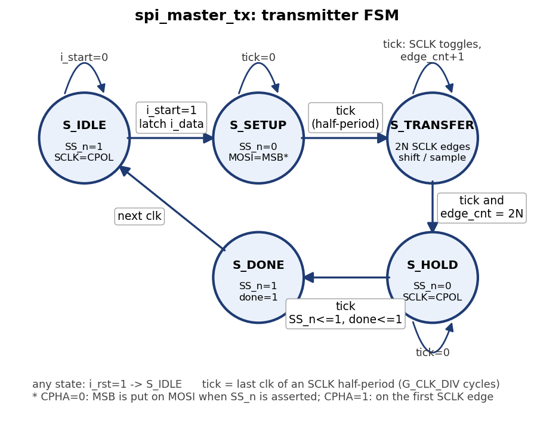

# Проєкт SPI master

## Протокол SPI
SPI — синхронний повнодуплексний протокол master/slave з чотирма лініями:
`SCLK` (такт від master), `MOSI` (дані master → slave), `MISO` (slave → master),
`SS_n` (вибір slave, активний нуль). За один період SCLK обидві сторони
одночасно передають по одному біту, старшим бітом вперед.

Режим задається двома параметрами:
- **CPOL** — рівень SCLK у спокої (0 — низький, 1 — високий);
- **CPHA** — фаза: 0 — дані зчитуються на *передньому* фронті біта і змінюються на
  задньому, перший біт виставляється одразу після `SS_n = 0`; 1 — дані змінюються на
  передньому фронті і зчитуються на задньому.

| Режим | CPOL | CPHA | Зчитування | Зміна даних |
|---|---|---|---|---|
| 0 | 0 | 0 | ↑ | ↓ |
| 1 | 0 | 1 | ↓ | ↑ |
| 2 | 1 | 0 | ↓ | ↑ |
| 3 | 1 | 1 | ↑ | ↓ |

## Структура
```
spi_master
├── spi_master_tx   FSM, дільник частоти, SCLK, SS_n, MOSI, строб o_sample
└── spi_master_rx   зсувний регістр MISO, o_data / o_valid
```
`f_SCLK = f_clk / (2 · G_CLK_DIV)`; за замовчуванням 50 МГц / 8 = 6.25 МГц.

## FSM передавача


| Стан | Виходи | Перехід |
|---|---|---|
| `S_IDLE` | `SS_n = 1`, `SCLK = CPOL` | `i_start = 1` → запам'ятати слово, `SS_n ← 0`, (CPHA=0) `MOSI ← MSB` → `S_SETUP` |
| `S_SETUP` | `SS_n = 0` | `tick` (півперіод SCLK, setup slave) → `S_TRANSFER` |
| `S_TRANSFER` | на кожному `tick` SCLK інвертується, `edge_cnt + 1`; зсув MOSI / строб `o_sample` за правилами режиму | `edge_cnt = 2N` і `tick` → `S_HOLD` |
| `S_HOLD` | `SCLK = CPOL`, `SS_n = 0` | `tick` (hold slave) → `SS_n ← 1`, `done ← 1` → `S_DONE` |
| `S_DONE` | `SS_n = 1` | наступний такт → `S_IDLE` |

`tick` — останній такт півперіоду SCLK (лічильник `div_cnt` до `G_CLK_DIV − 1`).
Синхронний скид `i_rst` з будь-якого стану → `S_IDLE`.

## Логіка приймача
Приймач не має власного таймінгу: передавач виставляє `o_sample` рівно в тому
такті, коли формує фронт зчитування (передній при CPHA = 0, задній при CPHA = 1).
Slave змінив MISO на пів періоду SCLK раніше, тож дані стабільні. На кожному
стробі `shift_reg ← shift_reg(N−2..0) & MISO`; після N-го біта слово
копіюється в `o_data` і на один такт піднімається `o_valid`.

## Верифікація
`tb/tb_spi_master.vhd` для кожного з 4 режимів має: DUT, поведінкову модель slave
(приймає MOSI і віддає свої слова на MISO на фронтах свого режиму) і монітор
протоколу (рівень SCLK у спокої, 16 фронтів на 8-бітну передачу, SCLK не
перемикається при `SS_n = 1`). Передається 7 слів, останні два — без паузи.
Перевіряється обидва напрямки: slave отримав те, що передав master, і master
отримав те, що передав slave.
